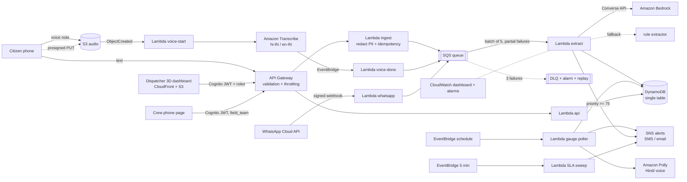
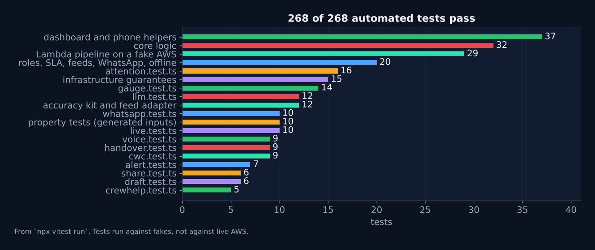

<div align="center">


# BaadhMitra · बाढ़मित्र

**Serverless flood-rescue triage for Bihar, built on AWS.**
Hindi, Hinglish and dialect voice or text reports become one ranked, de-duplicated rescue queue on a live 3D map. Rescue crews get their own phone page, and nothing waits unnoticed.

[](https://github.com/antrikakashyap/baadhmitra/actions/workflows/ci.yml)


### [Open the 3D demo](https://dr2l39p60xv7s.cloudfront.net/index.html?demo=1) · [Citizen report page](https://dr2l39p60xv7s.cloudfront.net/report.html) · [Crew page](https://dr2l39p60xv7s.cloudfront.net/field.html) · [Staff dashboard (login)](https://dr2l39p60xv7s.cloudfront.net/)

<sub>Live links point to the author's personal AWS test deployment and may be offline. The demo runs entirely in your browser with invented messages; no real people or data.</sub>

</div>

> **Where it stands:** a complete, working prototype running on the author's own AWS account, built to go into a one-district shadow pilot. It has not yet been used in a real flood and no agency has endorsed it; extraction accuracy on real messages is what the pilot measures, and river levels are simulated (labelled `sim`) until an official feed is connected, though the danger marks they are compared with are the official CWC ones. The road to a pilot is in [`docs/PILOT.md`](docs/PILOT.md), and the full picture is [at the end of this page](#where-it-stands-and-where-a-pilot-takes-it).

## Contents

[The problem](#the-problem) · [See it](#see-it) · [How one message travels](#how-one-message-travels) · [Use cases](#use-cases) · [Shift handover](#12-the-next-shift-gets-a-sheet-of-paper) · [Under the hood, with graphs](#under-the-hood-with-graphs) · [Roles](#who-can-do-what) · [Architecture](#architecture) · [Design decisions](#design-decisions-worth-knowing) · [Tests](#tests-and-evaluation) · [Run and deploy](#run-the-dashboard-locally-no-aws-needed) · [API](#api) · [Docs](#docs-for-a-real-pilot) · [Where it stands](#where-it-stands-and-where-a-pilot-takes-it)

---

## The problem

Every monsoon the Kosi, Gandak and Ganga basins flood. Control rooms get a flood of calls and WhatsApp voice notes ("paani ghar mein ghus gaya, bachche chhat pe hain") that are unstructured, duplicated, and often have no coordinates. Boats go to whoever shouts loudest, not to whoever is in the most danger, and once a boat is sent nobody is sure whether the request is still open.

BaadhMitra tries to fix four things: **understanding** messy messages, **ranking** them fairly, **dispatching** with a visible clock, and **learning** from the dispatchers' own corrections.

## See it

<p align="center">
  
  <br/><sub><b>Drag to orbit.</b> Real Three.js terrain, rivers, flood plane and incident beacons, driven by the same shared code as the Lambdas (demo mode, invented data).</sub>
</p>

<p align="center">
  
  <br/><sub><b>Monsoon surge:</b> gauges climb, the flood plane rises, Hindi alerts fire, and the queue re-ranks itself.</sub>
</p>

<p align="center">
  
  <br/><sub><b>Dispatch in two clicks:</b> open the top incident, see the evidence, send a boat team. The boat sails to the beacon.</sub>
</p>

<table>
  <tr>
    <td width="50%"><br/><sub><b>Rescue queue + 3D map.</b> Twenty reports from one village are one incident, scored 0 to 100 with the evidence beside it.</sub></td>
    <td width="50%"><br/><sub><b>Early warning.</b> Gauges in danger, Hindi voice alerts, and grey "stale" cards when a source stops updating.</sub></td>
  </tr>
  <tr>
    <td width="50%"><br/><sub><b>Overdue clock + live crews.</b> Amber and red badges for waiting incidents; blue markers for crews that share their location.</sub></td>
    <td width="50%"><br/><sub><b>Response-time report.</b> Time to assign and resolve, who closed it, and how often dispatchers agreed with the system.</sub></td>
  </tr>
  <tr>
    <td width="50%"><br/><sub><b>Accountability.</b> Every assign, resolve, dismiss and replay is logged: who, what, when.</sub></td>
    <td width="50%"><br/><sub><b>Role-based login.</b> Cognito, no self sign-up.</sub></td>
  </tr>
</table>

<table>
  <tr>
    <td width="260" align="center"></td>
    <td valign="top">

### The citizen page works with no signal
Hindi first, big buttons, installable as a PWA. A report typed offline is saved on the phone and sent when the network returns. It never asks for a phone number, shows **112** at the top, and says plainly that a report is not a rescue guarantee.

Try it: [`/report.html`](https://dr2l39p60xv7s.cloudfront.net/report.html)

</td>
  </tr>
  <tr>
    <td width="260" align="center"></td>
    <td valign="top">

### The rescue crew's page
`/field.html`, sign-in required (role `field_team`). Shows only the incidents assigned to that crew, with a navigation link and big one-tap buttons. Taps are queued on the phone and sent when the signal returns. "Done" and "nobody found" need a second tap to confirm, and "nobody found" sends the incident back to the queue flagged for a human.

Small things for a crew in a boat: a new assignment shows a banner, vibrates the phone and puts `(1)` in the tab title; every job says how long ago it was assigned; the screen stays awake while the location is being shared; the Hindi or English choice is remembered.

</td>
  </tr>
</table>

## How one message travels

<p align="center"></p>

| Step | What happens | Why it is built that way |
| --- | --- | --- |
| 1. Arrive | Text from the phone page, a voice note (S3 then Transcribe), or a signed WhatsApp webhook | Three doors, one pipeline; the phone page works offline |
| 2. Guard | Per-sender limit (30/hour), API throttles, optional WAF, phone numbers and ID-like numbers redacted | A panicked family cannot flood the queue; personal data is gone before storage |
| 3. Queue | SQS with partial-batch retry and a dead-letter queue | A burst of messages is buffered, a bad one never blocks the rest |
| 4. Extract | Bedrock reads place, depth, people, needs, vulnerable people; the rule extractor takes over if the model is down | The system degrades instead of stopping |
| 5. Merge and score | Reports in the same area become one incident with a 0 to 100 priority | One village crying twenty times is one rescue |
| 6. Show | 3D map, ranked queue, evidence panel, overdue chips | A dispatcher decides in seconds, not minutes |
| 7. Dispatch | A person assigns a crew; the crew gets it on their phone | A human stays in charge |
| 8. Close the loop | Crew taps on the way / arrived / done; silent crews and unassigned incidents trigger the overdue clock | Nothing sits forgotten |

## Use cases

Each case below runs through code that exists in this repo and is covered by a test. Messages are invented examples, not real reports.

### 1. A family on a roof sends a message

A message goes in; structured facts come out. This table is the real output of the rule extractor (`npm run docs:data` regenerates it). With Bedrock enabled the model does the reading and these rules are the safety net.

| Message | Place | People | Depth | Needs | Vulnerable | Severity |
| --- | --- | --- | --- | --- | --- | --- |
| सुपौल में पानी कमर तक है, 20 लोग फंसे हैं, बच्चे और बुजुर्ग भी, नाव चाहिए और खाना | Supaul | 20 | 100 cm | boat, food | yes | 5 |
| Kursela me paani chhat par aa gaya, 6 log hain, ek garbhwati mahila, dawai chahiye | Kursela | 6 | 300 cm | medical | yes | 5 |
| Naugachia: water at chest level, 12 people on the roof, need boat and drinking water | Naugachia | 12 | 300 cm | boat, water | no | 5 |
| खगड़िया में बाढ़ का पानी घर में घुस गया, बच्चे भूखे हैं, राशन चाहिए | Khagaria | - | - | food | yes | 3 |
| मचान पर चढ़ल बानी, गरभवती मेहरारू बा, अन्न नइखे, पानी में डूबल घर | **unplaced** (goes to a human list) | - | 200 cm | food | yes | 5 |
| paani aa gaya ghar me, call [phone] | **unplaced** (goes to a human list) | - | - | - | no | 2 |

Two rows are deliberately honest. The Bhojpuri message gives **no place**, so it is not guessed onto the map; it lands in the *unplaced* list for a human. And the last message had a phone number, which was **redacted** before anything was stored.

### 2. Twenty people from one village, one incident

During a flood the same place is reported many times. The dashboard shows one incident per area, so dispatchers read 15 lines instead of 25. Independent reporters raise priority, but one phone repeating itself counts once.

<p align="center"></p>

### 3. The queue decides who goes first

The ranking weighs severity first, then independent reporters, number of people, children, elderly, medical need. A boat request does not change the score (it is a need, not a danger). Once a crew is assigned the incident drops out of the urgent list.

### 4. A dispatcher sends a boat team

Open the top incident, read the evidence, choose a team, press dispatch. The action is checked on the server for the dispatcher's role and written to the audit log. See the dispatch GIF above.

### 5. The crew works from a phone with bad signal

The crew signs in on `/field.html`, sees only its own incident, taps **on the way**, **arrived**, **done**. Taps queue on the phone if the network drops and replay later. If they tap **nobody found**, the incident returns to the queue flagged for a human instead of closing silently.

### 6. Nobody is allowed to wait forever

An incident with no team, or a team that went quiet, turns amber and then red, and a single alert goes to the ops topic when it turns red (not every five minutes).

<p align="center"></p>

### 7. A false report is dismissed, and a new one reopens it

A dispatcher can dismiss a duplicate or false incident. If a new, independent person reports the same place afterwards, the incident reopens automatically with a fresh clock instead of staying buried.

### 8. A river approaches its danger mark

The gauge poller compares levels with the danger mark, voices a Hindi alert with Amazon Polly, and notifies via SNS. With a real feed configured the simulator is never used, and a source that stops updating is greyed out instead of alerting on old numbers.

<p align="center"></p>

### 9. The control room learns whether the system is right

After handling an incident a dispatcher can mark it right or wrong (and which field was wrong). The report page shows time to assign, time to resolve, who closed it and the agreement rate. That is how real accuracy gets measured in a pilot, instead of guessed.

### 10. The dashboard says what needs a human right now

Above the queue, a "Needs attention" list is recomputed on every refresh from data the system already has: incidents unassigned or silent past their limit, open incidents while no crew has shared a recent position, rivers that a straight-line estimate puts at their danger mark within six hours, reports without a place, reports needing a human look, and stale gauge readings. Red means act now, yellow means look. Each item that points at an incident opens it. It fixes nothing by itself and invents nothing; the thresholds are starting values to agree with the control room.

### 11. Small conveniences for a busy control room

- Send a crew the details: an incident has buttons to open its map spot, copy a short brief (place, people at risk, needs, a map link, no citizen message text) and send it on WhatsApp.
- The browser tab title shows the open or overdue count, so it is visible when the tab is in the background.
- If the connection drops, the header says "showing data from 10:32" instead of quietly showing an old queue.
- An optional sound (off by default, button in the header) plays a short beep when a new urgent incident (priority 75 or more) appears.
- On the citizen page, a half-written report is kept for six hours, so a reload or a dead battery does not cost the person their words.
- Keys: `/` search, `j` and `k` next and previous incident, `Esc` close. The language you pick is remembered.
- On the citizen page, a rate-limited send says so in Hindi and keeps the report; a send the server refuses for good is dropped instead of retrying forever; a flaky network never loses a report.
- The crew page announces new jobs (banner, vibration, tab title), shows how long ago each job was assigned, keeps the screen awake while sharing location, and remembers the language (see "The rescue crew's page" above).
- River gauge readings outside the region are ignored, and only the newest reading per station is kept, so one noisy station cannot crowd out the rest.

### 12. The next shift gets a sheet of paper

Control rooms keep paper logs, and paper still works when a screen, the network or the power does not. The **🖨 Handover** button in the dashboard header opens a one-page sheet:

- open and assigned incidents, most urgent first, with how long each has waited and an overdue mark when the clock has run out
- every rescue crew, busy ones first, and how many minutes ago it last shared a position
- rivers near or above the danger mark, or on course to reach it within six hours; readings that have gone stale are left out, and simulated ones are marked as simulated
- a notes box, and lines for "handed over by", "received by" and a signature

**Print** sends only the sheet to the printer; the map, the queue and the buttons are hidden by a print stylesheet. The sheet carries place, counts and needs and never a citizen's own words or a sender id. It is correct for the minute it was printed, so file it as the record of that changeover. It is in Hindi and English.

## Under the hood, with graphs

### Priority score

The score is computed by `shared/score.ts`. These curves are produced by calling that real function with one input changed at a time.

<p align="center"></p>

Read it as: severity moves the score the most; more independent reporters help but flatten after a handful (so a crowd cannot push a minor incident to the top); the number of people rises on a log scale; vulnerable people and medical need add points; a boat request alone adds none; assigning a crew lowers priority because someone is already on it. Scores also decay slowly with age so old unreviewed reports sink.

### Overdue clock

Thresholds live in `shared/sla.ts`: open incidents warn at 15 minutes and breach at 30 if the score is 75 or more (30 and 60 otherwise); an assigned crew that stays silent warns at 60 and breaches at 120. A sweep Lambda runs every five minutes, and a field called `esc` makes sure each breach alerts once. These are starting values to agree with a control room, not official standards.

## Who can do what

| Role | Sees | Can do |
| --- | --- | --- |
| `viewer` | queue, map, gauges, crew positions, metrics | nothing that changes data |
| `control_room` | everything a viewer sees | assign, resolve, dismiss, give feedback |
| `district_officer` | everything | also replay the dead-letter queue, read the audit log, export feedback |
| `field_team` | only its own assigned incidents | send position, tap progress |

Enforced by the API on every call, not just hidden in the UI. Accounts are created by an administrator; there is no self sign-up.

## Architecture



## Design decisions worth knowing

| Concern | Decision |
| --- | --- |
| Duplicate reports | Idempotency key per (sender, text, 10 min). One phone texting ten times counts once in the incident's reporter count, so a panicked family cannot inflate its own priority, and spam is cheap to ignore. |
| Lost updates | Incident writes use optimistic locking (`ver` + conditional put) with a retry loop. Two reports for the same village arriving together both land. |
| Poison messages | SQS partial batch response, 3 receives, then a dead-letter queue with a CloudWatch alarm and a `POST /admin/replay` redrive endpoint. |
| Bedrock outage or throttling | 9 s timeout, then the offline rule extractor. The fallback rate is a metric on the dashboard. |
| Prompt injection | Reports are untrusted. The model only produces data that is validated field by field (enums, ranges, known needs). Nothing the model says triggers an action. |
| Privacy | Phone numbers, Aadhaar-style numbers, UPI ids and emails are redacted before storage and before any text reaches the model. Sender ids are salted hashes. Audio expires after 30 days, reports after 7. |
| Never drop a cry for help | A report that cannot be placed on the map goes to an `unplaced` list for a human instead of being discarded. Low-confidence incidents are flagged for review until several independent people corroborate them. |
| Human in the loop | The system ranks and recommends. A dispatcher assigns teams. A person can dismiss a false or duplicate incident; a new independent report re-opens it. |
| Real vs simulated data | With a real gauge feed configured the simulator is never used. Old readings are greyed out, raise no alerts, and trigger an alarm. |
| Access | Cognito with no self sign-up and role groups, enforced by the API on every call, plus an append-only audit log. |
| Cost control | On-demand DynamoDB, ARM Lambdas, extractor concurrency capped at 5, per-route API throttles. Nothing idles when there is no flood. |
| Offline resilience | The gazetteer works with no network call, the phone pages queue their taps, and the dashboard runs end to end in a demo mode with the same shared code as the Lambdas. |

## Tests and evaluation

<p align="center"></p>

```bash
npm run typecheck && npm test      # 268 tests: core logic, the Lambda pipeline against a fake AWS, the gauge poller, the WhatsApp webhook, voice notes and the extractor with a good, bad or missing model, roles and audit, feeds, offline queue, CDK guarantees, accuracy kit, failure injection and property tests
npm run coverage                   # same tests plus a CI gate: 95% lines/functions, 85% branches (now about 98% / 88%)
npm run eval                       # extractor benchmark (add LLM=1 MODEL=<id> to score Bedrock)
npx cdk synth                      # validates the CloudFormation template
npm run loadtest -- <api> 200 20 --yes   # load test the public endpoint (use a staging stack)
npm run eval:ind -- labels.csv           # score on messages labelled by other people (see below)
npm run feed:check -- sample.json map.json # check a real gauge feed before wiring it in
npm run docs:data && npm run docs:graphs # regenerate the numbers and graphs in this README
```

| Area | Tests | What they prove |
| --- | --- | --- |
| Core logic (`shared.test.ts`) | 22 | extraction, redaction, scoring, merging, geohash |
| Roles, SLA, feeds, WhatsApp, offline (`gov.test.ts`) | 20 | dialect words, dismissal, village lookup, signatures, offline queue, overdue and metrics maths |
| Lambda pipeline (`pipeline.test.ts`) | 24 | the whole flow on a fake AWS: field team flow, role isolation, overdue sweep, rate limit, audit, feed region and de-duplication |
| Infrastructure (`stack.test.ts`) | 15 | four role groups, only five public methods, five-minute sweep, WAF opt-in, alarms, validated feed map, feed credential, CORS lock-down |
| Gauges, alerts, WhatsApp, voice, model fallback (`gauge`, `alert`, `whatsapp`, `voice`, `llm`) | 52 | gauge states and trend, a once-a-day feed that lists only sites in flood, alert wording in both languages, webhook signature, voice notes, the extractor with a good, bad or missing model |
| Dashboard and phone helpers (`filter`, `csv`, `queue`, `pingrule`, `mfa`, `villages-import`, `logic`) | 37 | queue search, CSV export, single-flight outbox, crew pings, two-step enrolment, village import, crew suggestions and time-to-danger |
| "Needs attention" panel (`attention.test.ts`) | 16 | every kind of problem, its red or yellow level, ordering, and the case where the crew list has not loaded |
| Official river marks and bulletin feed (`cwc.test.ts`) | 9 | 18 stations, warning always 1 m under danger, unknown station refused, published JSON in step with the code, a codes-and-levels feed turned into full readings, and the feed file made from a real bulletin accepted by the poller |
| Conveniences (`share`, `live`, `draft`) | 22 | crew brief without citizen text, connection-lost wording, tab title, sound switch, saved report draft and its expiry |
| Crew page helpers (`crewhelp.test.ts`) | 5 | which jobs are new, "N min ago" in both languages, tab title |
| Shift handover (`handover.test.ts`) | 9 | ranking, closed incidents left out, overdue marks, crew order, which rivers are listed, simulated marking, signature lines, place names inserted as text not markup |
| Accuracy kit and feed adapter (`kit.test.ts`) | 12 | CSV parsing, label normalisation, confidence intervals, labeler agreement, foreign gauge feeds mapped without inventing values |

The CWC bulletin reader is Python and has its own 18 tests (`python/tests/test_cwc.py`), run in CI against two real bulletins kept in `test/fixtures/cwc/`: the levels printed, the India-time observation stamp, a day with no site in flood, a refusal when the tables disagree with the summary count, several files at once (newest wins, a bad one skipped), wildcards in Windows CMD, file-name candidates, and a non-PDF reply never being saved.

On top of these, `npm run e2e` runs 20 Playwright browser tests against the built site in demo mode (ranked queue, search and filters, the attention panel, crew suggestions, sharing a brief, dialogs, keys, surge and the printable handover sheet; the citizen page keeping a report offline, a saved draft surviving a reload, a rate-limited send; the crew page announcing a new job and remembering the language). They run in CI and need no AWS.

What the tests do **not** cover: a live AWS account, real WhatsApp traffic, real phones' GPS, or any real flood message. The pipeline tests run on fakes.

An honest note on the benchmark: `eval/labeled.json` is a starter set of 41 messages written by the project author alongside the rule extractor. It scores 100% on place, depth, people, vulnerable and severity and 97.4% on needs (precision, recall and F1), so it is a regression guard, not an accuracy claim. Writing the set already exposed a real bug (the Hindi phrase "aa gaya" was being read as the city Gaya), now fixed and tested. To quote accuracy, label fresh messages you did not use while building and report per-field scores on those.

## Proving it: three things only other people can supply

The weakest points of this project are the ones the author cannot fix alone. The tooling for each is built; the evidence is not yet collected, and this README will not claim it until it is.

| Gap | Tooling in this repo | Status |
| --- | --- | --- |
| **Accuracy on messages nobody tuned for** | [`label.html`](eval/independent/label.html) (offline labeling page), [`LABELING.md`](eval/independent/LABELING.md) (protocol: writers and labelers kept apart, two labelers, 100+ messages), `npm run eval:ind` (per-field scores with 95% confidence intervals and labeler agreement) | **Not run.** Needs other people to write and label messages. |
| **Real river data** | A config-driven feed adapter (`FEED_MAP`: field paths, units, station table), `npm run feed:check`, and a data-request email in [`DATA-REQUEST.md`](docs/DATA-REQUEST.md) | **No official feed connected.** Levels stay `sim`. |
| **Practitioner feedback** | Demo and request emails in English and Hindi ([`outreach/`](docs/outreach)), a ten-question [feedback form](docs/outreach/FEEDBACK-FORM.md), and an honest log, [`FEEDBACK.md`](docs/FEEDBACK.md) | **None collected yet.** The log is empty on purpose. |

## Docs for a real pilot

| Doc | For |
| --- | --- |
| [`PILOT.md`](docs/PILOT.md) | one-district shadow pilot: scope, what the department provides, what to measure, risks |
| [`DEPLOY-INDIA.md`](docs/DEPLOY-INDIA.md) | region, staff accounts (Windows CMD commands), real gauge feed, village data, go-live checklist |
| [`SOP.md`](docs/SOP.md) | control-room runbook: working the queue, what to do when something breaks |
| [`SECURITY.md`](docs/SECURITY.md) · [`PRIVACY.md`](docs/PRIVACY.md) | what is protected, known gaps, data handling notes for legal review |
| [`WHATSAPP.md`](docs/WHATSAPP.md) | connecting the Meta WhatsApp Business webhook |
| [`CWC-FEED.md`](docs/CWC-FEED.md) | the daily CWC bulletin as a river-level feed: what it contains, the upload routine, how to switch it on |
| [`DATA-REQUEST.md`](docs/DATA-REQUEST.md) | asking an agency for gauge data, then wiring the feed |
| [`outreach/`](docs/outreach) · [`FEEDBACK.md`](docs/FEEDBACK.md) | demo request emails, feedback form, the feedback log |
| [`PITCH.md`](docs/PITCH.md) · [`DEMO-SCRIPT.md`](docs/DEMO-SCRIPT.md) | one-page pitch and a 5-minute demo script |

## C# port, checked against the TypeScript

`dotnet/BaadhMitra.Core` is a C# (.NET 8) version of the pure decision rules: priority score, overdue clock, great-circle distance, time-to-danger and crew ranking. The deployed system runs the TypeScript; the C# is not in the Lambdas. It is there for teams that live in .NET (a state data centre, a GIS or ERP integration) and want the same rules without re-deriving them.

Two copies of a rule drift apart quietly, so `npm run vectors` writes about 2,200 inputs and the TypeScript's answers to `conformance/vectors.json`, and `dotnet/Conformance` replays them against the C#. CI regenerates the file, fails if it changed, and runs the replay. Locally: `npm run vectors`, then `dotnet run -c Release --project dotnet/Conformance -- conformance/vectors.json`.

What this proves: same answers on those inputs, including rounding edges (JavaScript rounds halves up, C# rounds to even by default, so the port handles it). What it does not: that the rules themselves are right; that is the job of the evaluation and a pilot.

## Repo layout

```
shared/     code used by Lambdas, the dashboard and tests (geohash, gazetteer, redaction,
            extractor, scoring, SLA and metrics, attention rules, alert wording, gauge simulator)
backend/    Lambda handlers: ingest, voice, extract, api, gauge, whatsapp, sla (+ lib: intake, auth, feed, wa)
infra/      AWS CDK stack (TypeScript)
web/        3D dispatcher dashboard (Three.js + Vite) with the attention panel and printable handover sheet,
            offline citizen report page (saved draft), rescue-crew page (new-job alerts)
docs/       pilot plan, deploy checklist, runbook, security, privacy, WhatsApp, pitch, demo script, assets
dotnet/     C# (.NET 8) port of score, SLA, distance, time-to-danger and crew ranking, plus a conformance runner
conformance/ test vectors generated from the TypeScript (the C# port must reproduce every one)
scripts/    deploy, village importer, load test, feed checker, CWC bulletin reader, README data and graph generators
data/       cwc-latest.json, the river levels written by the bulletin job from the PDFs in inbox/
eval/       author benchmark, plus independent/ (labeling page, protocol, scorer)
test/       unit tests and CDK assertion tests
```

## Run the dashboard locally (no AWS needed)

```bash
npm ci
npm run web          # opens the 3D dashboard in demo mode
```

Click an incident, dispatch a team, type a report, or press **Simulate monsoon surge** to watch the water rise and Hindi alerts fire.

## Deploy to AWS

Prerequisites: AWS credentials for the target account (`aws configure` or `aws sso login`), AWS CLI v2, Node 22, and in your chosen region (default `ap-south-1`, Mumbai; your organisation may restrict regions, the prototype ran in `ap-southeast-2`: `aws configure set region <region>`): Amazon Bedrock model access, Amazon Transcribe, and Amazon Polly (Kajal, neural, hi-IN).

```bash
AWS_REGION=ap-south-1 MODEL_ID=<a Bedrock model or inference-profile id you can use> ./scripts/deploy.sh
```

The script runs the tests, builds the 3D dashboard, bootstraps CDK, deploys the whole stack (API, Lambdas, SQS + DLQ, DynamoDB, S3, EventBridge, SNS, CloudWatch, CloudFront site) and prints the dashboard URL and the citizen page URL. Create the first staff account with `ADMIN_EMAIL=you@example.com ./scripts/deploy.sh`, or with the two CLI commands in `docs/DEPLOY-INDIA.md`, then sign in.

Alternatives: run the same script from AWS CloudShell, or use **Actions > deploy** in GitHub (set the repository variable `AWS_ROLE_ARN` to an IAM role that trusts GitHub OIDC for this repo).

Manual steps, if you prefer: `npm ci && npm run web:build && npx cdk bootstrap && npx cdk deploy -c modelId=<id>`, then create a Cognito user and add it to a group (`docs/DEPLOY-INDIA.md`).

Optional settings: `-c gaugeFeedUrl=https://...` (feed shaped `[{id,name,river,lat,lon,lvl,danger,ts?}]`, or any other shape with `-c gaugeFeedMapFile=map.json`, see `docs/DATA-REQUEST.md`), `-c reportRps=50`, `-c waf=true`. Without a feed, readings are simulated and flagged.

If Bedrock access or the model id is wrong, the system keeps working on the rule extractor and the dashboard shows the fallback count rising. To remove everything: `npx cdk destroy` (the DynamoDB table is retained by design).

## API

| Route | Auth | Purpose |
| --- | --- | --- |
| `POST /reports` | public, throttled, per-sender limit | `{text, sender?, lat?, lon?}` |
| `POST /upload-url` | public, throttled | presigned URL for a voice note |
| `POST /subscribe` | public, throttled | email for alerts |
| `GET/POST /whatsapp` | public, HMAC signature checked | Meta webhook |
| `GET /incidents`, `/gauges`, `/alerts`, `/stats`, `/unplaced` | Cognito, any role | dispatcher data |
| `POST /incidents/{id}/assign`, `/resolve`, `/dismiss`, `/feedback` | Cognito, `control_room` or `district_officer` | dispatch actions and the accuracy verdict (audited) |
| `GET /teams`, `GET /metrics` | Cognito, any staff role | crew positions, response-time report |
| `POST /field/ping`, `GET /field/mine`, `POST /field/{id}/progress` | Cognito, `field_team` only | the crew's own phone |
| `POST /admin/replay`, `GET /audit`, `GET /feedback` | Cognito, `district_officer` | redrive the dead-letter queue, activity log, labelled-feedback export |

## Where it stands, and where a pilot takes it

BaadhMitra is a working prototype, deployed end to end on AWS and exercised by 268 unit tests and 20 browser tests. This section is the map for judges and for a first district: what is already proven, what needs a partner to prove, and what comes next.

### Proven in the build

- **Official river marks are in.** The warning, danger and highest-flood levels of 18 Bihar stations on the Ganga, Kosi, Gandak, Burhi Gandak, Bagmati, Ghagra and Sone are read from Central Water Commission flood bulletins (`shared/cwc.ts`, with the bulletin named per station) and ship as a ready feed-map table, `docs/cwc-bihar-stations.json`. Every warning mark is exactly 1 m under its danger mark, which is the rule the gauge state already used. What is still simulated is the *level* itself; that arrives with a live feed.

- **The whole pipeline runs:** message, redaction, queue, extraction, merge, score, dashboard, dispatch, crew phone, overdue clock, alert. The pipeline tests run it on a fake AWS; the deployed stack runs it for real.
- **Failures in the middle of a request are tested, not assumed.** Failure-injection tests make the queue, the report write or the alert topic fail halfway. Two real bugs came out of that and are fixed: a failed enqueue used to leave the duplicate marker behind, so the phone's retry was silently dropped as a "duplicate"; and an alert failure after an incident was saved made the queue retry the message and count the report twice. Now the marker is released and the alert failure is only logged.
- **Invariants are checked on generated inputs.** Property tests (fast-check) run thousands of random report sequences and require: priority always 0 to 100, every report counted once, unique reporters never above reports, severity and needs never shrink, the result independent of arrival order, more reporters never ranks lower, geohash and distance sanity, and redaction that is idempotent and never leaves a mobile number. Breaking the merge or score code on purpose makes them fail.
- **Traceable:** every step of a report writes one JSON log line carrying the report id (`rid`), never the message text or phone number, so one CloudWatch query follows a report from intake to alert. A test checks both.
- **CI gates:** coverage thresholds, `npm audit` on shipped dependencies at high severity, required settings (table, queue) that fail at first use instead of running with an empty name, and a synth-time warning when CORS is left open. Open item: the dev tools (vitest, vite) currently carry advisories that only matter on a developer machine; upgrading needs a major version move that is not done yet.
- **It degrades instead of failing:** Bedrock down means the rule extractor takes over; a network drop means the phone pages queue their taps; a stale river feed is greyed out and raises no alert.
- **People stay in charge:** the system ranks and recommends, a dispatcher assigns, every action is audited, and a "needs attention" panel and a printable handover sheet keep the control room and the next shift oriented.

### What a pilot unlocks

Each item below has its tooling built; the missing piece is a partner, not code.

| Next proof | What is ready | What it needs from a partner |
| --- | --- | --- |
| **Accuracy on real messages** | the labeling page, protocol and scorer (`npm run eval:ind`) with confidence intervals | 100+ messages written and labelled by people who did not build the extractor |
| **Real river levels** | the official station table above, a reader for the CWC daily bulletin: upload the day's PDF to `inbox/` and a job updates `data/cwc-latest.json` ([`docs/CWC-FEED.md`](docs/CWC-FEED.md); CWC blocks automated downloads, so a person saves the PDF), and a config-driven adapter for any other feed | a **live** hourly feed agreed with CWC, NWIC or the state water resources department; the bulletin is daily and lists only sites at or above warning |
| **WhatsApp intake at scale** | a signed, tested webhook | a Meta business account and approval |
| **Village-level placement** | `npm run villages` importer | a licensed village dataset (the shipped index is empty on purpose) |
| **SMS alerts in India** | SNS wiring | DLT registration; email alerts work today |
| **Dialect coverage** | a Bhojpuri and Maithili word list, with unplaced reports sent to a human | native-speaker review; Transcribe has no Maithili or Bhojpuri model, so Hindi is used for voice |
| **Crew tracking on real phones** | a battery-aware ping rule (about every 25 s moving, 3 min still), new-job vibration, wake lock | field trials on real handsets and real connectivity |
| **Hardening** | roles enforced on every call, audit log, optional two-step sign-in, WAF switch, `docs/SECURITY.md` | mandatory two-step sign-in, a locked CORS origin (`-c corsOrigin=...`), an independent penetration test |

The overdue thresholds (15/30 and 30/60 minutes, 60/120 for a silent crew) and the 75-point urgent line are starting values to agree with a control room, not official standards. The extraction benchmark in `eval/` is a regression guard written by the author, not an accuracy claim; real accuracy is what the pilot measures.

### Shipping a new version

The dashboard, the crew page and the citizen page are static files on CloudFront, so a release is one command, `npm run deploy` (build the site, then `cdk deploy`). It needs only an AWS account and the CDK; nothing else changes on the stack. `npx cdk destroy` removes everything (the DynamoDB table is retained by design).

### Roadmap

1. A first one-district shadow pilot following [`docs/PILOT.md`](docs/PILOT.md): run beside the real control room, change nothing for them, measure time to assign and agreement with dispatchers.
2. Resource-aware team suggestions (boat capacity, fuel, hours on duty).
3. IVR and missed-call intake for people with no data connection.
4. District-boundary heatmap of reports and response times.
5. A list screen for unplaced reports so a human can place them in one tap.
